# Lab 4 — Secure Connect and Communication Platform

**Course:** Web Dev III | **Unit:** 4 

A Node.js + Express backend demonstrating password hashing, JWT authentication, protected routes, role-based access control, Notes CRUD, Socket.IO chat, and Node.js EventEmitter events.

## Screenshots and Output Evidence

The following screenshots demonstrate the successful execution and functionality of the Secure Connect and Communication Platform.

### 1. User Signup
Demonstrates successful user registration with password hashing using bcrypt and JWT generation.

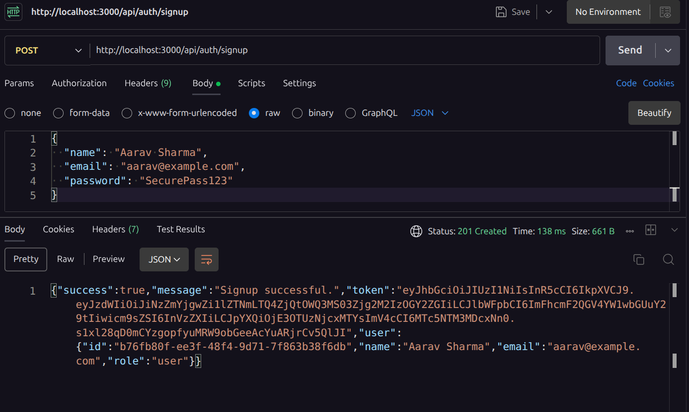

### 2. User Login
Demonstrates successful authentication using registered credentials and JWT token generation.

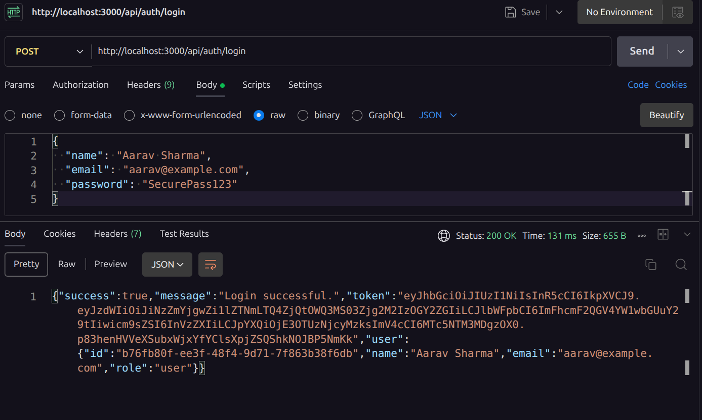

### 3. Unauthorized Access
Demonstrates that protected API routes reject requests without a valid JWT token, returning `401 Unauthorized`.

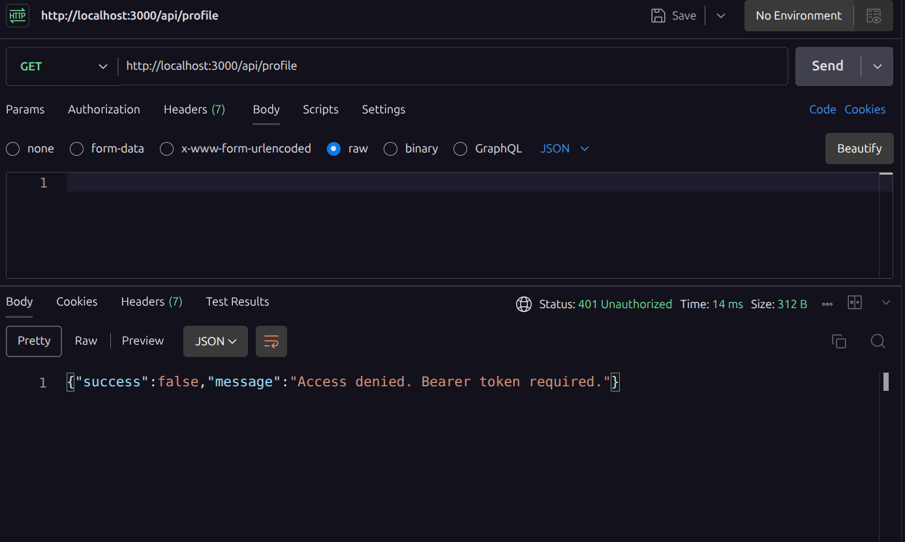

### 4. Authorized Access
Demonstrates successful access to a protected profile route using a valid JWT Bearer token.

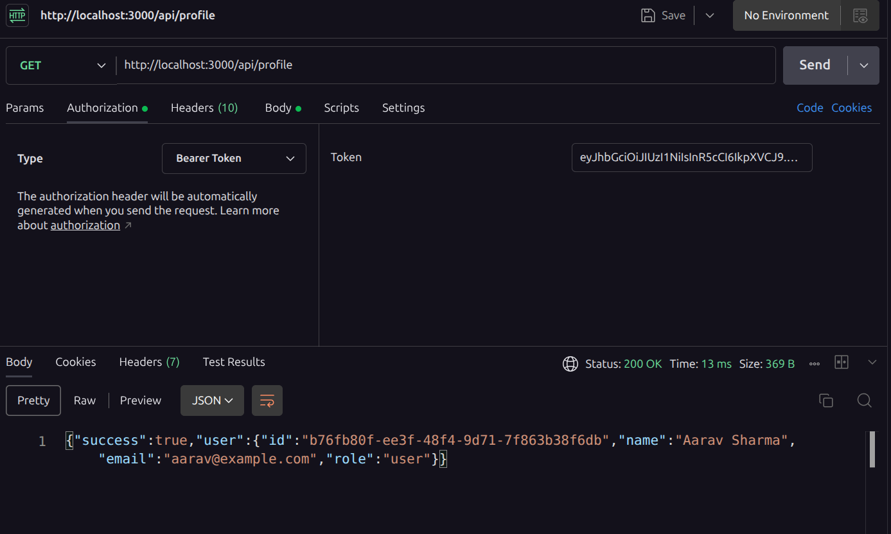

### 5. Create Note
Demonstrates creating a personal note through the authenticated Notes API.

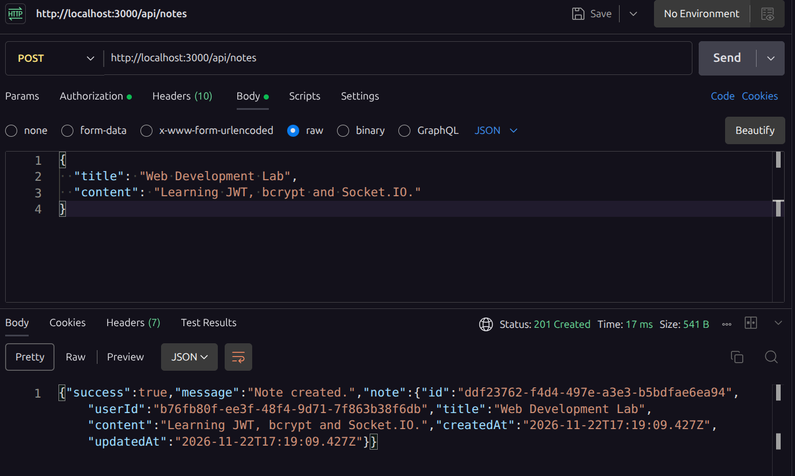

### 6. Retrieve Notes
Demonstrates retrieving the authenticated user's saved notes.

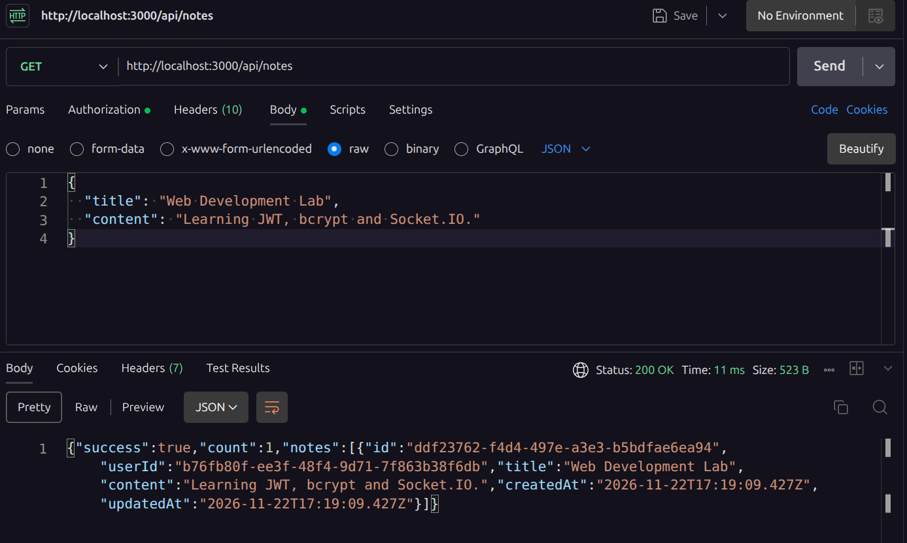

### 7. Update Note
Demonstrates updating an existing note using the PUT method.

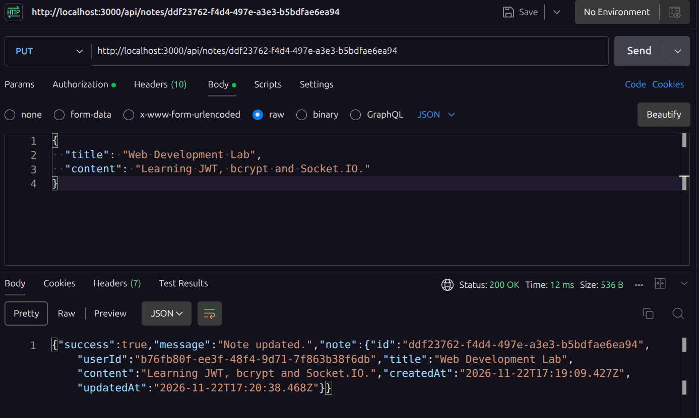

### 8. Delete Note
Demonstrates deleting an existing note using the DELETE method.

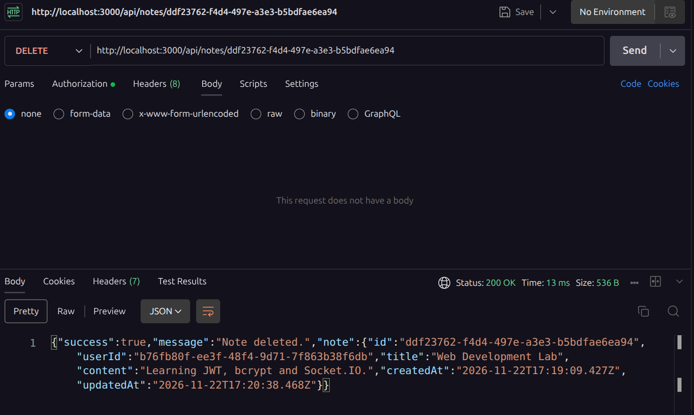

### 9. Real-Time Chat Communication
Demonstrates real-time, bidirectional messaging between two authenticated clients using Socket.IO.

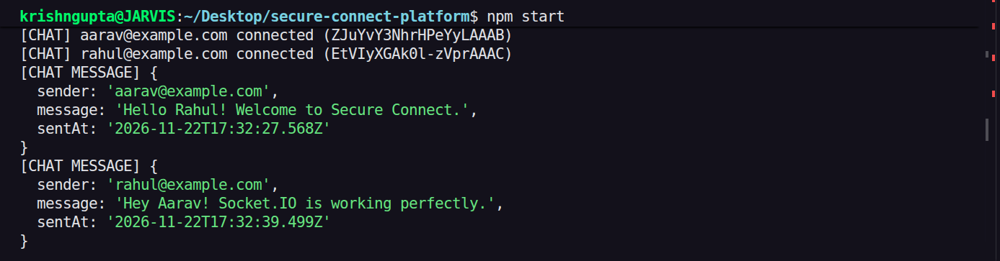

Browser view from both the tokens

### Aarav Chat
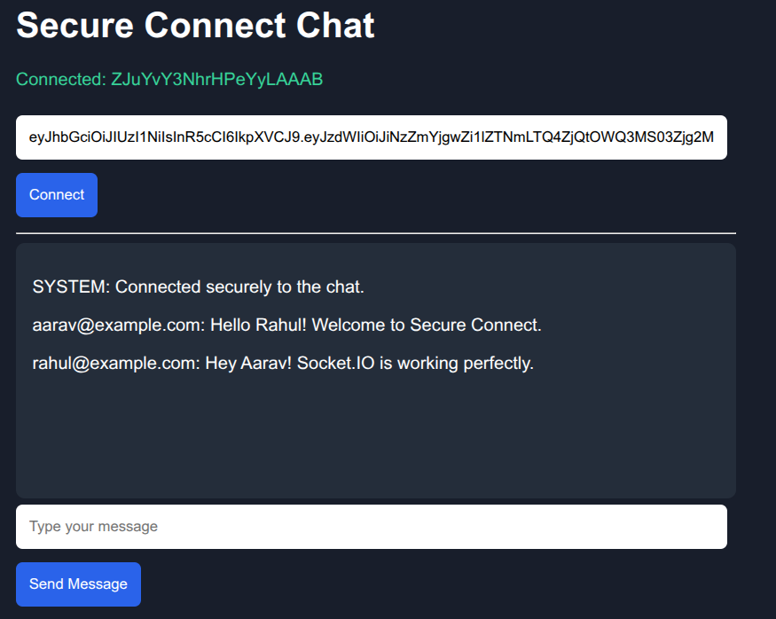

### Rahul Chat

### 10. Event-Driven Activity
Demonstrates Node.js EventEmitter functionality through signup and login events displayed in the server console.

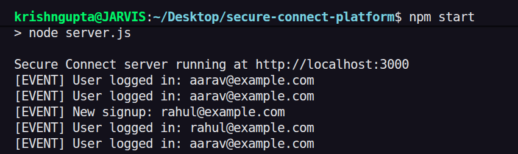

### 11. Role-Based Access Control (RBAC)
Demonstrates authorization restrictions for administrative resources based on user roles.

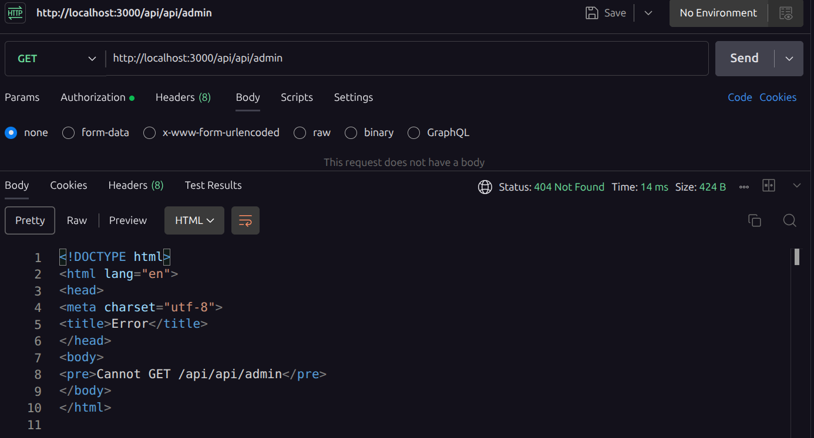